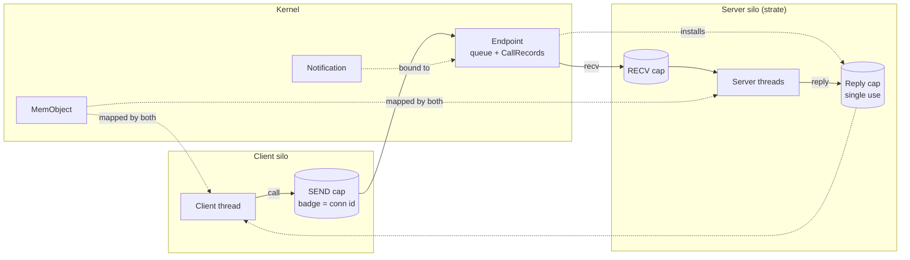
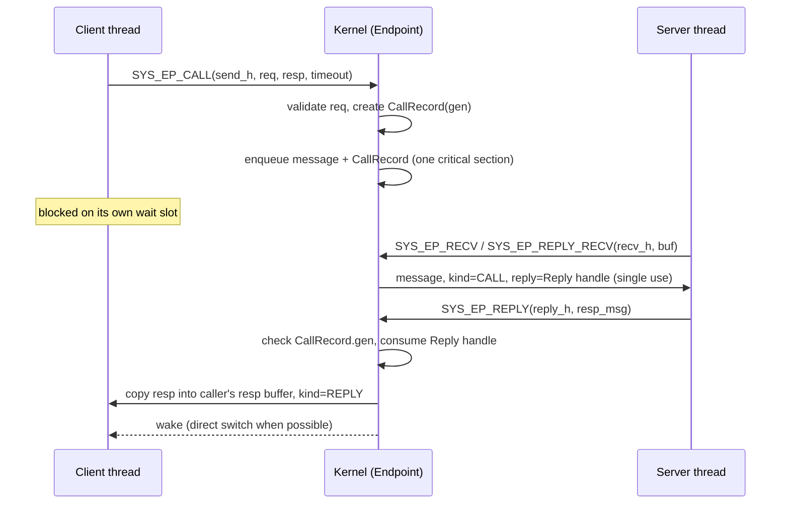
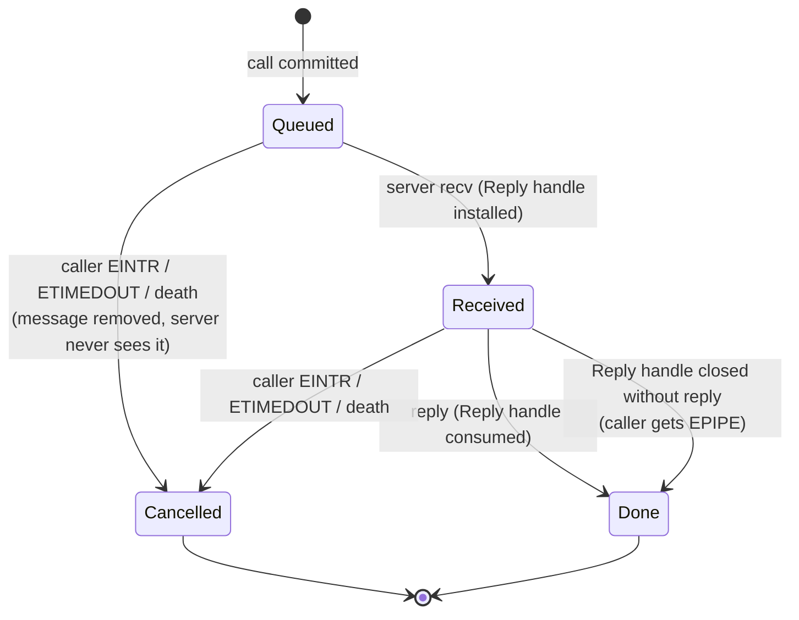

# IPC ABI v2 — Specification

> **Status: Draft — Phase 0–2 core implemented, unreleased.**
> Date: 2026-11-14. Target: `strat9-abi` **1.0** (`ABI_VERSION_MAJOR = 1`).
>
> This page specifies the replacement of every userspace IPC mechanism
> described in [IPC Mechanisms](./ipc-mechanisms.md) (ports, sync-channels,
> semaphores, shared rings, the N1/N2/N3 transport syscalls).
>
> The ABI types and syscalls **270–283** are implemented in the kernel and
> behind no feature flag; `ABI_VERSION_MAJOR` stays 0 until Phase 5, and the
> 0.x IPC remains the path `init` and the strates use.
> Section [§16](#16-implementation-status) records exactly what is and is not
> wired, [§14](#14-migration-plan) lists the migration phases and
> [§15](#15-defects-of-the-v1-abi-addressed-by-this-design) the v1 defects
> each design decision removes.

---

## 1. Goals and non-goals

### Goals

1. **Capability-only authority.** Every IPC object is reached through a
   handle carrying explicit rights. Nothing in a message, and no global
   integer id, ever grants authority.
2. **Unforgeable sender identity.** The receiver learns a *badge* fixed in
   the sender's capability and written by the kernel, never by the sender.
3. **Separate send and receive authority.** A client can never read a
   service's queue.
4. **One reply right per call.** A reply is bound to exactly one call; it
   survives multi-threaded servers, signals, timeouts and peer death without
   ever reaching the wrong caller.
5. **Atomic capability transfer.** Capabilities move with the message,
   resolved at send time, installed all-or-nothing at receive time.
6. **Bulk data through shared memory, signalling through the kernel.** The
   kernel copies small messages and signals; large data lives in memory
   objects mapped by both peers.
7. **Fits the existing architecture.** Silos (`OctalMode`, tiers, unveil),
   the Plan 9 style namespace, strates as userspace servers, the io_uring
   style `async_io` rings, and the N1/N2/N3 vocabulary are kept.
8. **No uninitialised byte crosses the boundary.** Every ABI struct is
   `repr(C)`, has explicit padding, derives `zerocopy::{FromBytes, IntoBytes,
   Immutable, KnownLayout}`, and is pinned by `abi/tests`.

### Non-goals

- POSIX message queues or sockets (the kernel still exposes no socket API).
- Kernel-to-kernel IPC (N1 stays a Rust-typed, kernel-internal facility,
  outside the ABI).
- Cross-machine transparency.

### Prior art

| Concept | Taken from |
|---|---|
| Endpoint, badged send caps, reply caps, `reply_recv`, bound notifications | seL4 |
| Handles with rights travelling inside messages, memory objects | Zircon |
| Synchronous call with direct thread switch and time donation | L4 / seL4 MCS |
| No hidden shared state between tasks, typed Rust IPC | Hubris |
| Submission/completion rings, `NEED_WAKEUP` flags | io_uring, virtio |

---

## 2. Object model

v2 introduces four kernel object types. All of them are reference-counted
kernel objects reached only through handles.

| Object | `ObjType` | Replaces | Purpose |
|---|---|---|---|
| **Endpoint** | `1` | `Port`, `SyncChan`, `IpcTransport` | Rendezvous for `send`, `call`, `recv` |
| **Reply** | `2` | `ReplyRegistry` keyed by `TaskId` | Single-use right to answer one call |
| **Notification** | `3` | `PosixSemaphore`, N2 notify, ring doorbells | 64-bit word of signal bits, lossless |
| **MemObject** | `4` | `SharedRing`, `SYS_MEM_REGION_*` | Shareable, mappable memory with rights |

Existing resource types (`File`, `Volume`, `Device`, `IoPortRange`,
`InterruptLine`, …) keep their current semantics but use the v2 handle
format and rights encoding (§3) and become transferable in messages when
they carry `RIGHT_TRANSFER`.



---

## 3. Handles and rights

### 3.1 Handle encoding

```text
 63      56 55                     24 23                      0
+----------+-------------------------+-------------------------+
|  0 (8)   |     generation (32)     |      table index (24)   |
+----------+-------------------------+-------------------------+
```

- A handle is a `u64` local to the **process** handle table. Value `0` is
  never a valid handle.
- The **generation** is incremented every time a table slot is reused, so a
  stale handle can never designate another object (no ABA).
- Bits 56–63 are always zero, so a handle returned in `RAX` never falls in
  the error window `[-4095, -1]` (`(-4095isize) as usize ..= usize::MAX`).
  Userspace must detect errors with
  `result >= (-4095isize) as usize` on the full 64-bit value.
- Handles are never global. Two processes holding the same object have
  unrelated handle values.

### 3.2 Rights

Rights are a `u32` bitmask. The low byte is generic, the upper bits are
type-specific. Every operation that derives a handle (duplicate, mint,
transfer) **intersects** the requested rights with the source rights: rights
can only shrink.

| Bit | Name | Meaning |
|---|---|---|
| 0 | `RIGHT_TRANSFER` | Handle may be placed in a message or granted |
| 1 | `RIGHT_DUPLICATE` | `SYS_HANDLE_DUPLICATE` allowed |
| 2 | `RIGHT_INSPECT` | `SYS_HANDLE_INFO` allowed |
| 3 | `RIGHT_WAIT` | Usable with `SYS_HANDLE_WAIT` / async poll |

| Bit | Endpoint | Notification | MemObject |
|---|---|---|---|
| 8 | `EP_SEND` — `send`, `call` | `NOTIF_SIGNAL` | `MEM_READ` |
| 9 | `EP_RECV` — `recv`, `reply_recv` | `NOTIF_WAIT` | `MEM_WRITE` |
| 10 | `EP_MINT` — derive badged SEND handles | `NOTIF_MINT` | `MEM_EXEC` |
| 11 | `EP_XFER` — messages through this handle may carry handles | — | `MEM_MAP` |

A **Reply** handle has no type-specific right: holding it is the right to
answer. It carries `RIGHT_TRANSFER` (a server may delegate the answer to a
worker process) and nothing else.

### 3.3 Badges

- Every Endpoint SEND handle and every Notification SIGNAL handle carries an
  immutable **badge** (`u64`), set when it is minted and never changed.
- Endpoint badge: delivered in `MsgHeader.badge` on every message sent
  through the handle. Badge `0` means *unbadged*.
- Notification badge: the mask of bits the handle is allowed to set
  (`notif_signal(bits)` sets `bits & badge`).
- A badge identifies a **delegation**, not a task. Servers must not assume
  that two different badges are two different processes.

---

## 4. Message format

### 4.1 Header

```rust
/// 40 bytes, align 8. Fields marked (K) are written by the kernel on
/// receive; on send they must be zero (otherwise `EINVAL`).
#[repr(C)]
#[derive(FromBytes, IntoBytes, Immutable, KnownLayout)]
pub struct MsgHeader {
    pub label: u32,        // protocol opcode, chosen by the sender
    pub data_len: u32,     // valid bytes in the data buffer
    pub ncaps: u16,        // number of CapXfer entries used
    pub flags: u16,        // protocol flags, opaque to the kernel
    pub kind: u8,          // (K) MSG_KIND_*
    pub _rsvd0: [u8; 3],   // must be zero
    pub sender_silo: u32,  // (K) sid of the sender silo, or 0 (see EP_FLAG_SENDER_SILO)
    pub _rsvd1: u32,       // must be zero
    pub badge: u64,        // (K) badge of the SEND handle, or signalled bits
    pub reply: u64,        // (K) Reply handle when kind == MSG_KIND_CALL, else 0
}

pub const MSG_KIND_SEND: u8 = 1;   // one-way message
pub const MSG_KIND_CALL: u8 = 2;   // `reply` holds a Reply handle
pub const MSG_KIND_NOTIF: u8 = 3;  // bound notification fired; `badge` = bits
pub const MSG_KIND_REPLY: u8 = 4;  // written into the caller's response header
```

`label` and `flags` belong to the protocol and are never interpreted by the
kernel. No kernel-owned value shares a field with a user-owned value.

### 4.2 Capability transfer entries

```rust
/// 16 bytes. On send: describes a handle to transfer.
/// On receive: rewritten with the new handle, its rights and type.
#[repr(C)]
#[derive(FromBytes, IntoBytes, Immutable, KnownLayout)]
pub struct CapXfer {
    pub handle: u64,   // send: source handle   | recv: new handle in receiver table
    pub rights: u32,   // send: rights mask (RIGHTS_SAME = u32::MAX keeps all)
                       // recv: effective rights
    pub mode: u32,     // send: XFER_MOVE | XFER_COPY   | recv: ObjType
}

pub const XFER_MOVE: u32 = 1;      // source handle is removed on commit
pub const XFER_COPY: u32 = 2;      // requires RIGHT_DUPLICATE on the source
pub const RIGHTS_SAME: u32 = u32::MAX;
```

### 4.3 Buffer descriptor

```rust
/// 32 bytes. Passed by pointer to every message syscall.
#[repr(C)]
#[derive(FromBytes, IntoBytes, Immutable, KnownLayout)]
pub struct MsgBuf {
    pub hdr: u64,        // *mut MsgHeader
    pub data: u64,       // *mut u8
    pub data_cap: u32,   // capacity of `data` (receive side); ignored on send
    pub caps_cap: u32,   // capacity of `caps` in entries
    pub caps: u64,       // *mut CapXfer
}

pub const IPC_MAX_DATA: usize = 4096;
pub const IPC_MAX_CAPS: usize = 4;
```

- `data_len ≤ IPC_MAX_DATA` and `ncaps ≤ IPC_MAX_CAPS`, otherwise `EINVAL`.
  Larger payloads go through a MemObject (§9).
- `data` may be `0` when `data_len == 0`; `caps` may be `0` when
  `ncaps == 0`.
- Messages are no longer fixed-size: only `data_len` bytes are copied.

### 4.4 Send-side validation and commit

Sending is a two-phase operation, atomic from userspace's point of view:

1. **Validate.** Copy the header, check reserved fields, copy `data_len`
   bytes, and for every `CapXfer` resolve the handle, check
   `RIGHT_TRANSFER`, check `RIGHT_DUPLICATE` for `XFER_COPY`, check
   `EP_XFER` on the destination handle, compute
   `effective = rights & source_rights`. No table is modified.
2. **Commit.** Under the endpoint lock, enqueue the message. Only then are
   `XFER_MOVE` handles removed from the sender table. The transferred
   objects now live in the kernel-side `InFlight` message.

If the operation fails before commit (`EAGAIN`, `ETIMEDOUT`, `EINTR`,
`EPIPE`), the sender's table is unchanged. If a committed message is
destroyed undelivered (endpoint closed), its transferred handles are
released, not returned.

### 4.5 Receive-side delivery

1. The kernel looks at the head message without dequeuing it.
2. If `data_cap < data_len` or `caps_cap < ncaps`, the call fails with
   **`EMSGSIZE`**, writes the required `data_len` and `ncaps` into the
   header, and leaves the message at the head of the queue.
3. Otherwise it reserves `ncaps` (+1 for a Reply) slots in the receiver's
   handle table (`ENOSPC` if impossible; message stays queued), dequeues,
   copies data and header, installs handles, rewrites the `CapXfer` entries.

Delivery is all-or-nothing: either the receiver gets the full message with
all its handles, or the message stays queued.

---

## 5. Endpoints

### 5.1 Creation and minting

`SYS_EP_CREATE(queue_depth, flags)` creates an endpoint and returns one
handle with `EP_RECV | EP_MINT | RIGHT_WAIT | RIGHT_INSPECT`. The creator
receives **no SEND right**: it must mint one, which forces every SEND handle
to carry a deliberate badge.

| Flag | Effect |
|---|---|
| `EP_FLAG_SENDER_SILO` (bit 0) | Kernel fills `MsgHeader.sender_silo` on every message. Replaces the v1 `IpcLabel` injection into `flags`. |
| `EP_FLAG_FASTPATH` (bit 1) | Hint: favour direct switch on `call` (§10). No semantic change. |

`queue_depth` is `1..=256` (`0` selects 16). Queued bytes are charged to the
**sender's** silo IPC account (§12).

`SYS_IPC_MINT(handle, badge, rights)` derives a new handle from an Endpoint
(requires `EP_MINT`) or a Notification (requires `NOTIF_MINT`):

- Endpoint: the result has `EP_SEND` plus the requested generic rights,
  intersected with the source; its badge is `badge`.
- Notification: the result has `NOTIF_SIGNAL`; its badge is the bit mask it
  may set.
- `EP_MINT`/`NOTIF_MINT` are never propagated by minting.

### 5.2 Queue semantics

- FIFO per endpoint; messages from one sender keep their order.
- `send` is **buffered**: it returns once the message is committed to the
  queue. When the queue is full it blocks (or fails with `EAGAIN` under
  `IPC_NONBLOCK`, `ETIMEDOUT` after `timeout_ns`).
- `call` is **synchronous**: it returns once the reply arrives (§6).
- `recv` blocks until a message or a bound-notification signal is
  available. A pending notification is delivered before queued messages.
- A queued `call` and a queued `send` share the queue and its depth.

### 5.3 Endpoint lifetime

The endpoint is *closed* when its last handle carrying `EP_RECV` is closed
(or its holder dies). From then on:

| Party | Effect |
|---|---|
| Senders blocked on a full queue | Fail with `EPIPE` |
| Queued messages | Destroyed; their transferred handles released |
| Callers waiting for a reply (queued or already received) | Fail with `EPIPE` |
| Later `send`/`call` on SEND handles | Fail with `EPIPE` |
| Outstanding Reply handles | `reply` fails with `EPIPE`; handle consumed |

SEND handles keep the object alive only as a tombstone; it is freed with
the last handle.

---

## 6. Call and reply

### 6.1 Protocol



### 6.2 CallRecord and Reply handle

```text
CallRecord {
    caller:  weak reference to the calling thread (or async ring + user_data)
    gen:     u32, incremented on cancel / completion
    resp:    caller's response MsgBuf + its address space
    state:   Queued | Received | Done | Cancelled
}
```



Rules:

1. The CallRecord is created and linked **in the same critical section**
   as the enqueue. A reply can never arrive before the caller is
   registered.
2. The Reply handle is installed in the **process** handle table of the
   receiver. Any thread of that process may answer, and the handle may be
   transferred (`XFER_MOVE` only) to delegate the answer.
3. A Reply handle is consumed by `reply`, by `reply_recv`, or by closing it.
   A second use fails with `EBADF`.
4. A cancelled call never yields a reply to a later call: the Reply handle
   refers to the CallRecord and its generation, not to the caller's task id.
   A reply to a cancelled call fails with `EPIPE`.
5. A reply never blocks: the caller's response buffer was validated and
   pinned to the call at `call` time.

### 6.3 Response delivery

- The kernel writes the reply into the caller's `resp` buffers **through
  the caller's address space**, from the caller's context (sync) or the
  ring owner's context (async, §11). Never from the server's address space.
- If the caller's response buffers are too small, the caller gets
  `EMSGSIZE` with the required sizes in its response header, and the
  reply's transferred handles are released. Servers learn nothing about
  this failure (`reply` already succeeded).

---

## 7. Notifications

- A Notification holds a 64-bit word. `SYS_NOTIF_SIGNAL(h, bits)` performs
  `word |= bits & badge` and wakes one waiter. Signals are never lost and
  coalesce by OR.
- `SYS_NOTIF_WAIT(h, out_bits_ptr, flags, timeout_ns)` blocks until the
  word is non-zero, then atomically reads and clears it into `*out_bits`.
  `IPC_NONBLOCK` turns it into a poll (`EAGAIN` when zero).
- **Bound notification.** `SYS_EP_BIND_NOTIF(ep_recv_h, notif_wait_h)` binds
  a notification to an endpoint. A thread blocked in `recv` on that
  endpoint is woken by a signal and receives `kind = MSG_KIND_NOTIF`,
  `badge = bits`. One server loop can then serve calls, interrupts, ring
  doorbells and timers.
- Interrupt delivery to driver silos (`HardwareMode::INTERRUPT`) uses a
  notification bound to the IRQ line: one bit per line.

---

## 8. Namespace integration

| Syscall | Requires | Result |
|---|---|---|
| `SYS_NS_BIND(ep_h, path, flags)` | `ep_h` has `EP_RECV` · silo has `RegistryMode::BIND` · path allowed by unveil | Entry `path → endpoint`, **owned by the binding silo** |
| `SYS_NS_LOOKUP(path, rights)` | silo has `RegistryMode::LOOKUP` · path allowed by unveil | New SEND handle, badge = fresh **connection id**, rights ∩ `EP_SEND \| EP_XFER \| RIGHT_TRANSFER \| RIGHT_DUPLICATE \| RIGHT_WAIT` |
| `SYS_NS_UNBIND(path)` | owning silo, or silo admin | Entry removed; existing SEND handles keep working |

- `NS_BIND_REPLACE` (flag bit 0) replaces an existing entry **only** if it
  is owned by the same silo (hot restart of a strate) or the caller is silo
  admin. There is no path-prefix exception.
- Binding has **no side effect**: no capability is seeded, no bootstrap
  message is queued. `init` (or the silo admin) hands resources such as a
  `Volume` to a strate in an ordinary message.
- Connection ids are unique for the lifetime of the boot and never reused.
- `EP_MINT` is never obtainable through the namespace. A silo needs
  `RegistryMode::PROXY` to receive a handle carrying `EP_MINT` from another
  silo; without it the kernel strips `EP_MINT` on transfer.
- A **sandboxed** silo cannot call `NS_*` and cannot send handles out
  (`EPERM`); it keeps using the handles it already holds.

---

## 9. Memory objects and the N2 shared ring

### 9.1 MemObject

- `SYS_MEMOBJ_CREATE(size, flags)` allocates a zeroed, page-granular object
  charged to the creator's silo memory account. Returns a handle with
  `MEM_READ | MEM_WRITE | MEM_MAP | RIGHT_TRANSFER | RIGHT_DUPLICATE |
  RIGHT_INSPECT`.
- `SYS_MEMOBJ_MAP(h, addr_hint, offset, len, prot)` maps a page-aligned
  window. `prot` must be a subset of the handle's `MEM_*` rights. Returns
  the address. Unmapping uses `SYS_MUNMAP`.
- The object lives while a handle or a mapping refers to it. Shrinking
  rights before transfer (`rights = MEM_READ | MEM_MAP`) gives the peer a
  read-only view.

### 9.2 Ring protocol (`strat9_abi::ipc_ring`)

N2 becomes what the original design intended: a **userspace** SPSC ring in
a MemObject, with a Notification as doorbell. The kernel never touches the
ring contents.

```rust
#[repr(C, align(64))]
pub struct RingHeader {          // first 192 bytes of the MemObject
    pub magic: u32,              // b"S9RG"
    pub version: u16,            // 1
    pub _rsvd0: u16,
    pub slot_size: u32,          // bytes per slot, multiple of 64
    pub slot_count: u32,         // power of two
    pub _pad0: [u8; 48],
    // --- producer cache line (offset 64) ---
    pub tail: AtomicU32,         // written by producer only (Release)
    pub prod_flags: AtomicU32,   // RING_NEED_WAKEUP: producer sleeps on "space"
    pub _pad1: [u8; 56],
    // --- consumer cache line (offset 128) ---
    pub head: AtomicU32,         // written by consumer only (Release)
    pub cons_flags: AtomicU32,   // RING_NEED_WAKEUP: consumer sleeps on "data"
    pub _pad2: [u8; 56],
}
// Slots follow at offset 192: { len: u32, label: u32, data: [u8; slot_size - 8] }
```

Rules (implemented once, in the `strat9-ring` crate, host-tested):

- Indices are free-running `u32`; `slot = idx & (slot_count - 1)`;
  full when `tail - head == slot_count`.
- Producer: write slot, `tail.store(Release)`, then `fence(SeqCst)` and, if
  `cons_flags & NEED_WAKEUP`, `notif_signal(consumer_bit)`.
- Consumer: before sleeping, set `NEED_WAKEUP`, `fence(SeqCst)`, re-check
  `tail`, then `notif_wait`. Symmetric for the producer waiting on space.
- No syscall is made while the peer is actively polling.

---

## 10. N3: synchronous fast path

N3 is no longer a CR3-only migration. It is an **implementation property of
`call` and `reply_recv`**, invisible in the ABI:

- When a `call` finds a server thread blocked in `recv` on the same
  endpoint, the scheduler switches **directly** to that thread on the
  current CPU (no run-queue round trip), donating the caller's remaining
  time slice and priority (the server runs at `max(server, caller)`).
- `reply_recv` performs the inverse switch.
- The switch is a full thread switch: TSS `rsp0`, per-CPU GS data, FPU
  state and CR3/PCID go through the normal scheduler path.
- `ipc/n3.rs` (shared frame, IPI, watchdog, naked trampoline) is removed.

N1 remains the Rust-typed kernel-internal channel family (`channel::<T>`,
NIC ↔ scheduler mailbox). It is not part of the ABI.

### Tier policy

The `TransportManager` tier matrix becomes a **policy filter**, never an
authorisation source. Authority always comes from holding a handle. The
default policy:

| Source \ Dest | Critical | System | User |
|---|---|---|---|
| **Critical** | all | all | `call`/`send` · MemObject read-only for User |
| **System** | all | all | `call`/`send` · MemObject |
| **User** | `call` only | `call`/`send` · MemObject | `call`/`send` · MemObject |

"all" = messages, handle transfer, MemObject mapping. Violations fail with
`EPERM`. The silo admin can override per silo pair. `SYS_TRANSPORT_CREATE`
(transport to an arbitrary silo id) is removed.

---

## 11. Asynchronous operations

New `AsyncOp` opcodes replace `IpcSend = 10`, `IpcRecv = 11`,
`IpcCall = 12`, which are removed:

| Opcode | Value | SQE fields | CQE `res` |
|---|---|---|---|
| `EpSend` | 13 | `off` = handle · `addr` = `*MsgBuf` · `len` = `size_of::<MsgBuf>()` | `0` or `-errno` |
| `EpCall` | 14 | `off` = handle · `addr` = `*MsgCall` · `len` = `size_of::<MsgCall>()` | `0` or `-errno` |
| `EpRecv` | 15 | `off` = handle · `addr` = `*MsgBuf` | `kind` or `-errno` |
| `EpReply` | 16 | `off` = Reply handle · `addr` = `*MsgBuf` | `0` or `-errno` |
| `NotifWait` | 17 | `off` = handle · `addr` = `*u64` (bits out) | `0` or `-errno` |

```rust
#[repr(C)]
#[derive(FromBytes, IntoBytes, Immutable, KnownLayout)]
pub struct MsgCall { pub req: MsgBuf, pub resp: MsgBuf }   // 64 bytes
```

- `len` must equal the struct size, which versions the descriptor.
- Buffers must stay valid and mapped until the CQE is posted (io_uring
  rule).
- The kernel binds the operation to the **ring owner's address space** at
  submission; every copy-out happens in that address space, outside any
  IPC lock.
- `Cancel` (254) cancels a pending IPC operation with the same guarantees
  as a signal on a sync call (§6.2).

---

## 12. Silo integration and quotas

Each silo gets an `SiloIpcAccount`, modelled on `SiloMemoryAccount`:

| Counter | Charged to | Default limit |
|---|---|---|
| Endpoints | creator silo | 256 |
| Notifications | creator silo | 256 |
| Queued bytes (header + data) | **sender** silo, released at dequeue/destroy | 1 MiB |
| Handles in flight | sender silo | 1024 |
| MemObject bytes | creator silo, through `SiloMemoryAccount` | silo `mem_max` |

- Every object keeps an `Arc` to the account it charged and releases in
  its `Drop`. Closing a handle received from another silo never touches the
  closer's account.
- Accounts belong to the silo, so `fork` cannot reset them.
- Exceeding a limit fails with `ENOMEM` (creation) or `EAGAIN` (queued
  bytes, when `IPC_NONBLOCK`; otherwise the sender blocks).
- `OctalMode` mapping: `LOOKUP` → `NS_LOOKUP`; `BIND` → `NS_BIND`;
  `PROXY` → may hold foreign `EP_MINT`; `sandboxed` → §8.

---

## 13. Syscalls

New block **270–289** inside the IPC range. Every syscall takes at most six
arguments.

| # | Name | Arguments | Returns |
|---|---|---|---|
| 270 | `SYS_EP_CREATE` | `queue_depth, flags` | RECV handle |
| 271 | `SYS_IPC_MINT` | `handle, badge, rights` | new handle |
| 272 | `SYS_EP_SEND` | `send_h, *MsgBuf, flags, timeout_ns` | `0` |
| 273 | `SYS_EP_CALL` | `send_h, *MsgBuf req, *MsgBuf resp, flags, timeout_ns` | `0` |
| 274 | `SYS_EP_RECV` | `recv_h, *MsgBuf, flags, timeout_ns` | `kind` |
| 275 | `SYS_EP_REPLY` | `reply_h, *MsgBuf` | `0` |
| 276 | `SYS_EP_REPLY_RECV` | `reply_h, *MsgBuf reply, recv_h, *MsgBuf recv, flags, timeout_ns` | `kind` |
| 277 | `SYS_EP_BIND_NOTIF` | `recv_h, notif_h` | `0` |
| 278 | `SYS_NOTIF_CREATE` | `flags` | handle (`NOTIF_SIGNAL \| NOTIF_WAIT \| NOTIF_MINT`) |
| 279 | `SYS_NOTIF_SIGNAL` | `notif_h, bits` | `0` |
| 280 | `SYS_NOTIF_WAIT` | `notif_h, *u64 out_bits, flags, timeout_ns` | `0` |
| 281 | `SYS_NS_BIND` | `ep_h, path_ptr, path_len, flags` | `0` |
| 282 | `SYS_NS_LOOKUP` | `path_ptr, path_len, rights` | SEND handle |
| 283 | `SYS_NS_UNBIND` | `path_ptr, path_len` | `0` |
| 284 | `SYS_MEMOBJ_CREATE` | `size, flags` | handle |
| 285 | `SYS_MEMOBJ_MAP` | `mem_h, addr_hint, offset, len, prot` | address |
| 286–289 | reserved | — | `ENOSYS` |

Common flags: `IPC_NONBLOCK` (bit 0). `timeout_ns = 0` means no timeout;
`IPC_NONBLOCK` takes precedence over `timeout_ns`. `SYS_EP_REPLY_RECV`
always completes the reply part even if the receive part then fails.

The generic handle syscalls (`SYS_HANDLE_DUPLICATE`, `_CLOSE`, `_WAIT`,
`_INFO`) apply to every v2 object. `SYS_HANDLE_DUPLICATE` gains a `rights`
argument. `SYS_HANDLE_GRANT` (by pid) is **removed**: handles move between
processes only inside messages.

### 13.1 Errors

| errno | Value | Used for |
|---|---|---|
| `EBADF` | 9 | Invalid, stale, or consumed handle; wrong object type |
| `EPERM` | 1 | Missing right, silo mode, sandbox, or tier policy |
| `EINVAL` | 22 | Reserved field non-zero, sizes over limits, bad flags |
| `EFAULT` | 14 | Unmapped user buffer |
| `EAGAIN` | 11 | `IPC_NONBLOCK` and the operation would block |
| `ETIMEDOUT` | 110 | `timeout_ns` elapsed |
| `EINTR` | 4 | Signal while blocked (call cancelled per §6.2) |
| `EPIPE` | 32 | Peer endpoint closed, reply to a cancelled call, Reply dropped |
| `EMSGSIZE` | **90** (new) | Receive buffers too small; required sizes written back |
| `ENOSPC` | 28 | Receiver handle table full |
| `ENOMEM` | 12 | Silo IPC quota or kernel memory exhausted |
| `ENOENT` | 2 | `NS_LOOKUP` path not bound |
| `EEXIST` | 17 | `NS_BIND` path bound and not replaceable |

`EMSGSIZE = 90` matches Linux x86_64, like `ENOTSUP`.

### 13.2 Removed in 1.0

| Removed | Replacement |
|---|---|
| 200–208 `SYS_IPC_*` (ports) | Endpoints 270–276, namespace 281–283 |
| 210–211 `SYS_IPC_RING_*` | MemObject 284–285 + `ipc_ring` protocol |
| 220–224 `SYS_CHAN_*` | Endpoints |
| 230–234 `SYS_SEM_*` | Notifications 278–280 (and futexes 303–307) |
| 260–264 `SYS_TRANSPORT_*` | Endpoints + tier policy |
| 105–107 `SYS_MEM_REGION_*` | MemObject |
| 4 `SYS_HANDLE_GRANT` | Handle transfer in messages |
| `AsyncOp` 10–12 | `AsyncOp` 13–17 |
| `IpcMessage` (1 KiB fixed) | `MsgHeader` + `MsgBuf` + `CapXfer` |

---

## 14. Migration plan

| Phase | Content | Exit criterion |
|---|---|---|
| **0 — Foundations** | Per-process handle table with its own lock and `(index, gen)` handles; intrusive, unbounded `WaitQueue` with O(1) removal and native timeouts; disable `TransportLevel::Mmu` and arbitrary-silo `SYS_TRANSPORT_CREATE` | Existing L2 tests pass; new concurrency tests |
| **1 — `ipc-core`** | `no_std` crate holding the Endpoint / CallRecord / InFlight state machines, independent of the scheduler, model-checked on the host with `loom` and property tests | All interleavings of send/recv/call/reply/cancel/close covered |
| **2 — ABI 1.0 syscalls** | `strat9_abi::ipc_v2` types and constants, syscalls 270–285, errno 90; kernel keeps v1 behind the `ipc-v1` feature while `init` and the strates migrate | `abi/tests/ipc_v2_layout.rs`, `kernel-l2-tests`, syscall fuzzing |
| **3 — N2** | MemObject, `strat9_abi::ipc_ring`, `strat9-ring` crate; migrate `strate-net` | Reproducible TSC benchmark (none exists today) |
| **4 — Async + quotas** | `AsyncOp` 13–17, `SiloIpcAccount` | Async L2 tests |
| **5 — N3 and removal** | Direct switch on `call`/`reply_recv`; delete `n3.rs`, `port.rs`, `reply.rs`, `channel.rs` (`SyncChan`), `lockfree_ring.rs`, `shared_ring.rs`, `semaphore.rs` and the `ipc-v1` feature; bump `ABI_VERSION_MAJOR` to 1 | Round-trip `call` benchmark |

### Required ABI tests (`workspace/abi/tests/ipc_v2_layout.rs`)

- `size_of`/`align_of` and every field offset of `MsgHeader` (40/8),
  `CapXfer` (16/8), `MsgBuf` (32/8), `MsgCall` (64/8), `RingHeader` (192/64).
- `IntoBytes` derives compile (proves no implicit padding).
- Handle encoding: generated handles never intersect the error window.
- Syscall numbers 270–289 unique and inside the IPC block.

---

## 15. Defects of the v1 ABI addressed by this design

| v1 defect | Where | v2 answer |
|---|---|---|
| `msg.sender` holds a capability badge but is read back as a `TaskId` (recv handle transfer, reply target, port cleanup) | `syscall/ipc_port.rs`, `ipc/port.rs` | Badge is kernel-written and never interpreted; replies use Reply handles (§4.1, §6) |
| `msg.flags` doubles as transferred handle, protocol flags and injected silo label | `syscall/ipc_port.rs` | Separate `flags`, `CapXfer[]`, `sender_silo` (§4) |
| Handle transfer resolved at receive time from the sender's live table | `sys_ipc_recv` | Resolved and detached at send commit (§4.4) |
| `SYS_IPC_CONNECT` grants read on the service port | `sys_ipc_connect` | `NS_LOOKUP` yields SEND only (§8) |
| `/net` and `/srv/strate-*` replaceable by any binder; `Volume` seeded on bind | `sys_ipc_bind_port` | Owned entries, no side effects (§8) |
| Reply slot registered after the request is sent; reply lost | `sys_ipc_call` | CallRecord linked in the enqueue critical section (§6.2) |
| Replies keyed by `TaskId`; late reply reaches the next call; worker threads cannot reply | `ipc/reply.rs` | Single-use Reply handle with generation (§6.2) |
| Async reply written into the server's address space | `reply::deliver_reply` | Copy-out in the caller/ring-owner address space (§6.3, §11) |
| Message consumed before handle transfer or buffer checks complete | `sys_ipc_recv` | All-or-nothing delivery, `EMSGSIZE` (§4.5) |
| Quotas: non-atomic reserve, port quota never released, release by non-owner, reset by `fork` | `ipc/quota.rs`, `syscall/chan.rs` | Silo accounts released by object `Drop` (§12) |
| N2 notification no-ops; consumer never woken | `ipc/lockfree_ring.rs` | Shared-memory ring + Notification (§9) |
| N3 CR3-only migration (send currently always fails with `InvalidRip`) | `ipc/n3.rs` | Direct thread switch (§10) |
| Transport to any silo id without authorisation | `sys_transport_create` | Removed; authority from handles, tier matrix as policy (§10) |
| Global reusable ids (`PortId`, `ChanId`, `RingId`) | registries | Generation-tagged per-process handles (§3.1) |

---

## 16. Implementation status

Last verified: 2026-11-14 (`cargo check` for `x86_64-unknown-none`, with and without `--features selftest`, exit 0;
`cargo test -p strat9-abi` (incl. `ipc_v2_layout`) and `cargo test -p strat9-ipc-core` green).

| Piece | Where | State |
|---|---|---|
| Handle encoding, rights, message structs, `RingHeader`, errno 90, syscall numbers | `workspace/abi/src/ipc_v2.rs` | implemented, layout-pinned by `abi/tests/ipc_v2_layout.rs` |
| Generation handle table, `(index, gen)`, 256-handle cap, fork inheritance | `kernel/src/ipc/v2/handle.rs` | implemented |
| Endpoint, queue depth, bound notifications, close-on-last-RECV | `kernel/src/ipc/v2/endpoint.rs` | implemented |
| Reply object, single use, generation, close-without-reply ⇒ `EPIPE` | `kernel/src/ipc/v2/endpoint.rs` | implemented |
| Notification word, bound-endpoint signal routing | `kernel/src/ipc/v2/notif.rs` | implemented |
| 270 `EP_CREATE`, 271 `IPC_MINT`, 272 `EP_SEND` | `kernel/src/syscall/ipc_v2.rs` | implemented |
| 273 `EP_CALL`, 274 `EP_RECV`, 275 `EP_REPLY`, 276 `EP_REPLY_RECV` | `kernel/src/syscall/ipc_v2.rs` | implemented; reply copied out in the caller's context |
| 277 `EP_BIND_NOTIF`, 278 `NOTIF_CREATE`, 279 `NOTIF_SIGNAL`, 280 `NOTIF_WAIT` | `kernel/src/syscall/ipc_v2.rs` | implemented |
| 281 `NS_BIND`, 282 `NS_LOOKUP`, 283 `NS_UNBIND` | `kernel/src/syscall/ipc_v2.rs`, `kernel/src/namespace/v2.rs` | implemented; owned entries, no side effects, `LOOKUP` yields SEND-only badged handles |
| 284 `MEMOBJ_CREATE`, 285 `MEMOBJ_MAP` | `kernel/src/ipc/v2/memobj.rs`, `syscall/ipc_v2.rs` | implemented on the frame-ownership machinery of `SharedRing` (`allocate_ring`, no global registry): one owner reference per frame held by the object, a fresh mapping identity per page per mapping, so a frame is freed only when the object and every mapping are gone; size ≤ `MEMOBJ_MAX_SIZE` (64 MiB), `prot` ⊆ `MEM_*` rights |
| `AsyncOp` 13–17 | `kernel/src/ipc/v2/async_ops.rs`, `async_io/{dispatch,syscall,ring}.rs` | implemented: submission and retries run in the ring owner's context; blocking operations are parked and retried by `SYS_ASYNC_ENTER` when an IPC event kicks the ring (`Ring::ipc_kick`); `EpCall` shares `call_submit`/`call_finish` with the sync path; ring destruction abandons pending calls |
| `SiloIpcAccount` (§12) | `kernel/src/silo/memory_account.rs`, `kernel/src/ipc/v2/quota.rs` | implemented: counters live beside the silo memory budget and are reached through the caller's address space (no registry lock); RAII charges in endpoints, notifications, queued messages (sender silo) and MemObjects, released in `Drop`; a blocking sender waits on the quota, `IPC_NONBLOCK` gets `EAGAIN` |
| Timeouts (`timeout_ns != 0`) | `kernel/src/sync/waitqueue.rs` (`wait_until_deadline`), `syscall/ipc_v2.rs` | implemented on the scheduler's `wake_deadline_ns` (the `nanosleep` mechanism); `ETIMEDOUT`; resolution one tick (10 ms); a `call` deadline covers enqueue + reply |
| Receive reservation (§4.5) | `endpoint.rs` (`pop` → `PopOutcome::NeedSlots`), `syscall/ipc_v2.rs` | implemented: slot count checked against the reservation in the dequeue critical section, retry loop, no nested locks |
| N3 fast path (§10) | `process/scheduler/task_ops.rs` (`wake_task_here`), `WaitQueue::wake_one_here`, `endpoint.rs` | implemented as **directed wakeup** on `EP_FLAG_FASTPATH` endpoints: the call wakes the server on the caller's CPU (no IPI, affinity respected) and the reply wakes the caller on the server's CPU. Full scheduling-context donation is not implemented (see below) |
| Executable model of the state machines | `workspace/ipc-core` | 27 host tests, deterministic stress; loom interleaving not run |
| In-kernel runtime tests | `kernel/src/ipc/v2/selftest.rs` (task `ipc-v2-test`, selftest orchestrator) | reservation, `EMSGSIZE`, timeouts, sender wakeup, call states, quotas, MemObject; compiled; **not yet observed passing**: the `selftest` debug kernel does not reach the orchestrator (see below) |

Defects fixed on 2026-11-14 after the first implementation pass:

- **Receive reservation race.** The reservation was sized from a peek taken
  before `pop`; it was stale whenever the receiver blocked on an empty queue
  (reservation 0, then a message with handles arrives) or another receiver
  thread took the head. Now `pop` compares the head with the reservation
  under the endpoint lock and returns `NeedSlots(n)` without dequeuing.
- **Senders never woken.** `send_waitq` was only woken by `close`, so a sender
  blocked on a full queue stayed blocked after a receiver dequeued. `pop` now
  wakes one sender.
- **Reply visible before its payload.** `deliver_reply` set `Done` before
  storing the payload; a caller on another CPU could see `Done`, find no
  payload and return `EPIPE`. The payload is now stored first, under the same
  lock.
- **Late reply leaked.** A reply arriving between a caller's `EINTR` /
  `ETIMEDOUT` (or death) and its cancellation stayed in the slot with its
  handles (possibly an endpoint's last `EP_RECV`). `abandon_call` reclaims and
  releases it.
- **Call registry growth.** `CALL_SLOTS` was pruned only by exit/close scans,
  growing by one entry per call; it is now pruned amortised in
  `register_call`.

Runtime test status: the selftest harness exists (`process/selftest.rs`,
`cargo make kernel-test`) but its build was broken by unrelated code (two
`x86_64::VirtAddr` paths, and a call into the orphaned
`shell/commands/util/selftest.rs`, now skipped). With it compiling, the debug
`selftest` kernel still stops during `nic_init` **before** the orchestrator,
at `HEAD` as well (e1000e: `vmalloc KernelMapFailed` panic; with
`-nic none`: hang at "Scanning for network devices"). The IPC v2 runtime
tests run as soon as that boot path is fixed.

Remaining known differences from the normative text:

1. Timeout resolution is the scheduler tick (10 ms), not nanoseconds.
2. §10 asks for time-slice and priority donation on `call`; the kernel does a
   directed wakeup (same CPU, no IPI) but the local scheduler class still
   decides when the server runs. Donation needs a scheduling-context
   primitive the scheduler does not have.
3. MemObject accounting: the backing is charged to the creator at
   `SYS_MEMOBJ_CREATE` **and** each mapping is charged as a virtual region to
   the mapping silo, because `munmap` always refunds the mapping length (an
   uncharged mapping would let the refund credit bytes never charged). The
   same refund asymmetry affects `SYS_MEM_REGION_MAP` (`memory/region_cap.rs`,
   `SiloCharge::AlreadyCharged`) and is outside IPC v2.
4. The v1 IPC syscalls and `AsyncOp` 10–12 are still dispatched (`ipc-v1`
   removal is the last step of Phase 5).

§8 `PROXY`: enforced on receive. A handle carrying `EP_MINT` delivered to a
task whose silo lacks `RegistryMode::PROXY` (or is sandboxed) is installed
without `EP_MINT`; silo admin and tasks outside any silo keep it.

---

## See also

- [IPC Mechanisms](./ipc-mechanisms.md) — the v1 implementation as it is today
- [Silo System](./silo.md) — `OctalMode`, unveil, quotas
- [ABI Overview](./abi.md) and [ABI Changelog](./abi-changelog.md)
- [Syscall Reference](./syscalls.md)

### References

1. Klein, G. et al. (2009) : *seL4: Formal Verification of an OS Kernel*, SOSP — and the seL4 Reference Manual (endpoints, reply objects, notifications, MCS scheduling contexts)
2. Liedtke, J. (1995) : *On µ-Kernel Construction*, SOSP
3. Fuchsia project : *Zircon kernel objects* — channels, handles and rights, VMOs
4. Oxide Computer : *Hubris reference* — IPC and leases
5. Axboe, J. (2019) : *Efficient IO with io_uring*
6. OASIS : *Virtual I/O Device (VIRTIO) 1.2* — event suppression
