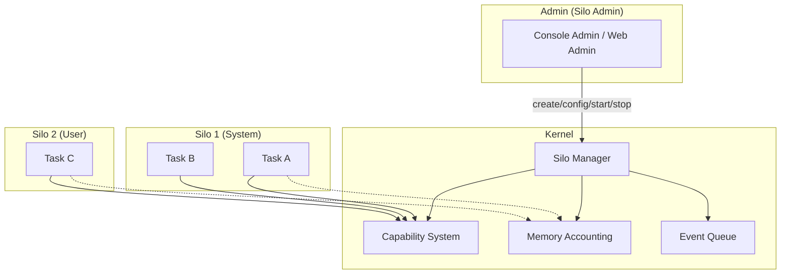
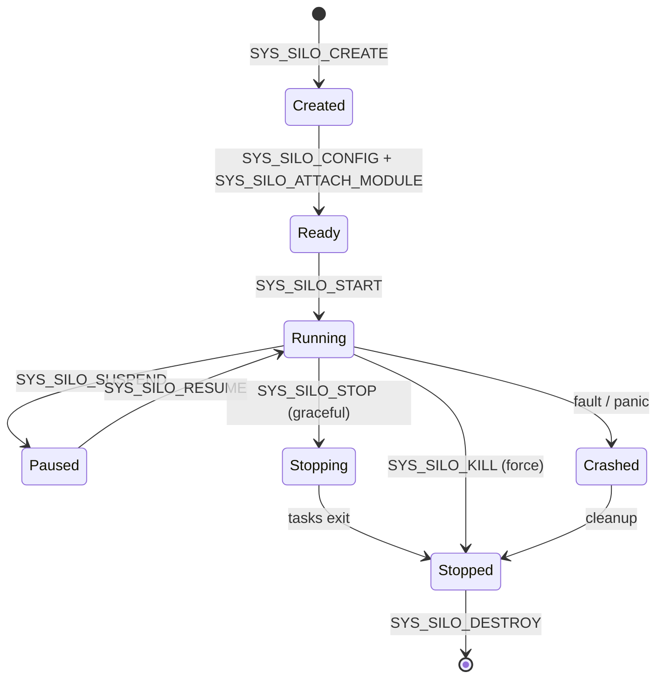

# Silo System

Silos are Strat9 OS's primary isolation mechanism. Each silo is a container for processes with bounded resources, restricted capabilities, and filesystem access control. Policy lives in userspace; the kernel enforces mechanisms.

---

## Overview



---

## Silo identity

Each silo has a numeric ID (`SiloId`) and a tier derived from the ID range:

| ID range | Tier | Purpose |
|----------|------|---------|
| 1–9 | `Critical` | Kernel system services (init, logger) |
| 10–999 | `System` | Drivers, filesystems, network |
| 1000+ | `User` | User applications |

User-tier silos cannot have hardware or control permissions (enforced at creation).

---

## Silo lifecycle



**States:** `Created → Loading → Ready → Running → Paused → Stopping → Stopped → Destroyed` (also `Crashed`, `Zombie`)

---

## Resource limits

The `SiloConfig` struct defines per-silo resource bounds:

```text
SiloConfig {
    mem_min: u64,           // Minimum guaranteed memory (bytes)
    mem_max: u64,           // Maximum allowed memory (0 = unlimited)
    cpu_shares: u32,        // CPU share weight (for proportional scheduling)
    cpu_quota_us: u64,      // CPU time quota per period (microseconds)
    cpu_period_us: u64,     // Quota period (microseconds)
    cpu_affinity_mask: u64, // CPU affinity bitmask
    max_tasks: u32,         // Maximum concurrent tasks
    io_bw_read: u64,        // Read bandwidth limit
    io_bw_write: u64,       // Write bandwidth limit
    flags: u64,             // Feature flags
    family: u8,             // Silo family (SYS/DRV/FS/NET/WASM/USR)
}
```

**Memory accounting:** `mem_usage_bytes` counts user virtual regions, including shared mappings, ELF segments, stacks and reservations. Each address space retains its silo's account, so mapping and cleanup charge the owner rather than the calling task. The quota lock is independent of the registry; contention never skips accounting. Threads share their process's account and forked address spaces reserve their own virtual-region budget.

**CPU and I/O quotas:** Nonzero `cpu_shares`, CPU time quotas/periods and I/O bandwidth limits are currently rejected with `NotSupported`; they are not silently accepted. CPU affinity remains supported.

**Stopping:** Stop requests send `SIGTERM` to user tasks; kill requests force termination. A silo stays `Stopping`, with its task associations intact, until scheduler cleanup completes. A task that ignores or blocks `SIGTERM` requires a kill request. Kernel tasks are forcibly terminated because they do not run user signal handlers.

---

## Grants (`SYS_SILO_GRANT`)

`SYS_SILO_GRANT(handle, desc_ptr, count)` applies 1–32 `SiloGrantDesc`
(32 bytes each) to an editable silo (`Created`, `Ready`, `Stopped`,
`Crashed`). Descriptor kinds:

| Kind | `id` | `len` | Meaning |
|------|------|-------|---------|
| `PATH` (1) | user pointer to UTF-8 path | byte length ≤ 1024 | Path subtree access; `access & 1` allows writes |
| `IRQ` (2) | interrupt line | 0 | Interrupt access |
| `PCI` (3) | `(bus << 16) \| (device << 8) \| function` | — | Exact PCI function access |
| `DMA` (4) | byte budget | 0 | DMA byte budget (summed) |

Enforcement is **deny-by-default per kind**: a silo with no PATH grant can
connect to any namespace path; once a PATH grant exists, only the exact path
or its subtree is allowed, and binding/writing needs a writable grant.
`SYS_PCI_ENUM` filters to PCI-granted functions; `SYS_PCI_CFG_READ/WRITE`
enforce exact addresses; DMA quotas become `min(config, sum(grants))`.
Admin tasks and tasks outside a silo are unrestricted.

**Family ceiling:** IRQ/PCI/DMA grants are accepted only for `SYS` and `DRV`
silos. PATH write grants require a family whose registry ceiling includes
`BIND` (`SYS`, `DRV`, `FS`, `NET`); `WASM` and `USR` may only receive
read-only PATH grants. Violations return `PermissionDenied`.

Grants are additive: `SYS_SILO_GRANT` cannot remove an existing entry. To
replace a silo's grant set, stop it and call
`SYS_SILO_GRANT_RESET(handle)`, which empties every grant; reapply the new
set with `SYS_SILO_GRANT` before restarting. This is the path used by live
`reload` reconfiguration. Reset is admin-only and accepted only in editable
states (`Created`, `Ready`, `Stopped`, `Crashed`); a `Running` or `Paused` silo
returns `EINVAL`.

---

## Live reload

`/srv/init reload` re-reads the boot configuration and reconciles the running
set. A silo whose validated plan changed is reconfigured **in place** on its
existing handle and SID; it is never recreated:

1. Stop the silo's strates (`SYS_SILO_STOP`, then `SYS_SILO_KILL` after the
   grace window), reverse plan order, and unload their modules.
2. Apply the new `SiloConfig` with `SYS_SILO_CONFIG` and replace the grant set
   by calling `SYS_SILO_GRANT_RESET` followed by `SYS_SILO_GRANT`.
3. Restart the declared strates on the same silo handle.

A silo is "changed" when any plan field other than its SID differs from the
last applied plan; its SID is always forced to the live value, so a silo is
never re-keyed by a reload. A plan entry with no strates is treated as a
removal. Removal stops the silo, unloads its modules and destroys it;
reconfiguration failure leaves the silo stopped and is reported as `failed`
rather than silently keeping the old configuration.

Zero-downtime is **not** provided: without task migration the silo is briefly
down between stop and restart, and running connections are re-established by
the restarted strates.

---

## Octal mode (pledge/unveil)

Access control uses an `OctalMode` with three permission groups, encoded as a 12-bit octal value:

| Bits | Group | Permissions |
|------|-------|------------|
| 8–10 | **Control** | `LIST` (0b100), `STOP` (0b010), `SPAWN` (0b001) |
| 5–7 | **Hardware** | `INTERRUPT` (0b100), `IO` (0b010), `DMA` (0b001) |
| 2–4 | **Registry** | `LOOKUP` (0b100), `BIND` (0b010), `PROXY` (0b001) |

Example: `0o755` = LIST+STOP+SPAWN + INTERRUPT+IO + LOOKUP+BIND

### Pledge

`SYS_SILO_PLEDGE(mode)` restricts the silo's permissions. The new mode must be a **subset** of the current mode : escalation is rejected with `PermissionDenied`.

```text
silo.mode.pledge(new_mode):
    if !new_mode.is_subset_of(self.mode):
        return PermissionDenied  // escalation attempt
    self.mode = new_mode
```

### Unveil

`SYS_SILO_UNVEIL(path, rights)` restricts filesystem access to specific paths with read/write/execute permissions. Multiple rules can be added; if a path matches no rule, access is denied.

**Rights bits:** `read (0x1)`, `write (0x2)`, `execute (0x4)`

**Matching:** A rule `/srv/data` matches `/srv/data/file.txt` but not `/srv/other`. Rule `/` matches everything.

### Enter Sandbox

`SYS_SILO_ENTER_SANDBOX()` is **irreversible** : it clears all registry permissions and prevents further capability grants. Once sandboxed, the silo cannot escape.

---

## Family types

| Family | Value | Purpose |
|--------|-------|---------|
| `SYS` | 0 | System services (init, admin) |
| `DRV` | 1 | Hardware drivers |
| `FS` | 2 | Filesystem handlers |
| `NET` | 3 | Network stack |
| `WASM` | 4 | WebAssembly runtime |
| `USR` | 5 | User applications |

---

## Feature flags

| Flag | Value | Description |
|------|-------|-------------|
| `SILO_FLAG_ADMIN` | `1 << 0` | Silo has admin capabilities |
| `SILO_FLAG_GRAPHICS` | `1 << 1` | Graphics session support |
| `SILO_FLAG_WEBRTC_NATIVE` | `1 << 2` | WebRTC native support (requires GRAPHICS) |
| `SILO_FLAG_GRAPHICS_READ_ONLY` | `1 << 3` | Graphics read-only mode |
| `SILO_FLAG_WEBRTC_TURN_FORCE` | `1 << 4` | Force TURN relay for WebRTC |

---

## Module system (CMOD)

Silos can load code modules in the `CMOD` binary format:

```text
Strat9ModuleHeader {
    magic: "CMOD",
    version: 1 or 2,
    cpu_arch: 0 (x86_64),
    flags: MODULE_FLAG_SIGNED | MODULE_FLAG_KERNEL,
    code_offset/size, data_offset/size, bss_size,
    entry_point,
    export/import/relocation tables,
    key_id, signature,
    cpu_features_required (v2+),
}
```

**Loading flow:**

1. Admin calls `SYS_MODULE_LOAD` with a blob (from file, IPC stream, or initfs path)
2. Kernel validates the header (magic, version, alignment, signature)
3. Module is registered in the global `ModuleRegistry`
4. Admin calls `SYS_SILO_ATTACH_MODULE` to bind the module to a silo
5. Admin calls `SYS_SILO_START` to launch the silo's entry point

---

## Events

The kernel pushes events to a fixed-capacity ring buffer (256 entries). Userspace polls via `SYS_SILO_EVENT_NEXT`.

| Event | Trigger |
|-------|---------|
| `Started` | Silo started or config updated |
| `Stopped` | Graceful stop |
| `Killed` | Force kill |
| `Crashed` | Fault/panic (data0 encodes fault reason + subcode) |
| `Paused` | Suspended |
| `Resumed` | Resumed from pause |

**Crash encoding:** `data0 = fault_reason | (subcode << 16)`

- `PageFault (1)`, `GeneralProtection (2)`, `InvalidOpcode (3)`

---

## Silo admin

Admin operations require a `ResourceType::Silo` capability with `grant` permission. The `SILO_ADMIN_RESOURCE` (resource 0) is the special admin handle.

**Bootstrap:** The init process receives a silo-admin capability at boot via `create_silo_admin_capability()`.

**Admin operations:**

| Operation | Function | Description |
|-----------|----------|-------------|
| Create | `kernel_spawn_strate()` | Register module, create silo, spawn task |
| Start | `kernel_start_silo()` | Transitions Ready → Running |
| Stop | `kernel_stop_silo()` | Graceful stop (tasks exit) |
| Kill | `kernel_stop_silo(force=true)` | Force kill all tasks |
| Destroy | `kernel_destroy_silo()` | Remove silo (must be stopped) |
| Rename | `kernel_rename_silo_label()` | Change silo label |
| Pledge | `sys_silo_pledge()` | Restrict permissions |
| Unveil | `sys_silo_unveil()` | Restrict filesystem access |
| Sandbox | `sys_silo_enter_sandbox()` | Lock down (irreversible) |

---

## Path-based label assignment

When a filesystem path matches `/srv/strate-fs-<type>/<label>/`, the label is automatically assigned to the silo. This allows convention-based service discovery.

---

## Silo vs. other isolation mechanisms

| Mechanism | Scope | Enforcement |
|-----------|-------|-------------|
| **Silo** | Process group + resources + capabilities | Kernel (SiloManager) |
| **Capability** | Individual resource access | Kernel (CapabilityManager) |
| **Pledge** | Syscall permission subset | Kernel (OctalMode) |
| **Unveil** | Filesystem path access | Kernel (UnveilRules) |
| **Sandbox** | Full lockdown (irreversible) | Kernel (sandboxed flag) |
